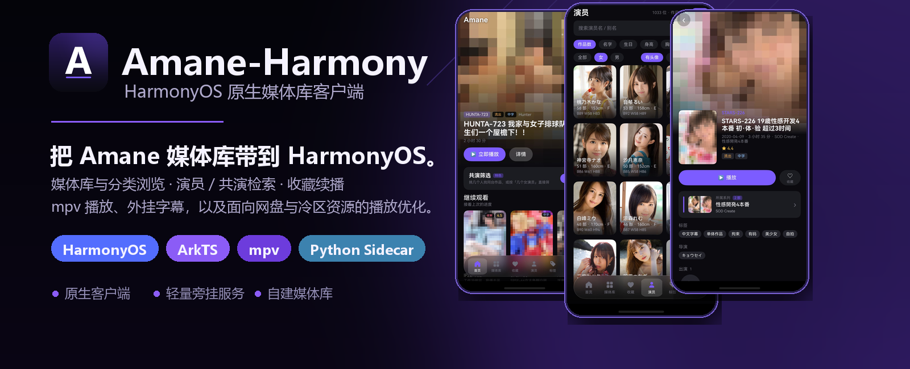
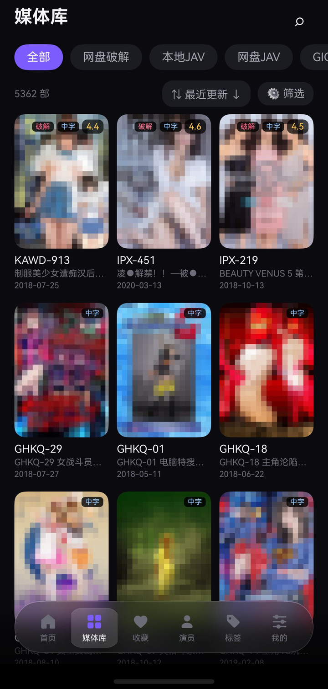
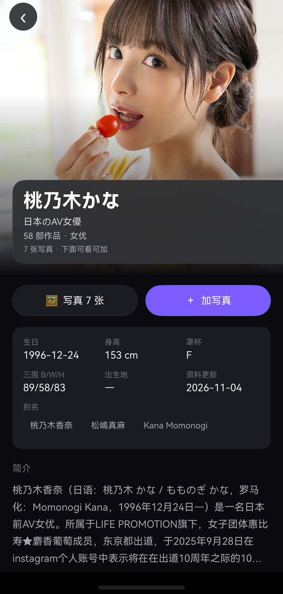

  

  
  
  
  
  
  

  <strong>把 Amane 媒体库带到 HarmonyOS。</strong> 
  原生媒体库浏览、演员 / 共演检索、收藏续播与 mpv 播放； 
  轻量 Python 旁挂服务补齐扩展 API、字幕与播放代理。

自建 [Amane](https://github.com/sqzw-x/amane) 媒体库的**鸿蒙原生客户端**，媒体库与分类浏览、共演检索、收藏续播、外挂字幕都在手机上完成；附带辅助用的旁挂服务：一个纯标准库的单文件服务，负责补齐筛选、字幕与播放代理这些 Amane 本体没有的能力。

> 截图取自作者自建媒体库，代表界面与真实数据；封面、横幅与剧照已统一打码处理。

## 界面预览

<table>
  <tr>
    <td align="center"> 首页</td>
    <td align="center"> 媒体库</td>
    <td align="center"> 演员</td>
    <td align="center"> 详情</td>
  </tr>
</table>

## 核心能力

<table>
  <tr>
    <td width="33%" align="center" valign="top">
       
      <strong>媒体库与分类浏览</strong> 
      多库入口、7 种排序、5 类可叠加筛选与滚动加载；标签、系列、制片商、发行商、导演同一套分类页，导演 / 制片商一行一条长图。
    </td>
    <td width="33%" align="center" valign="top">
       
      <strong>演员与共演检索</strong> 
      演员按性别、有头像、有资料、身高罩杯胸围段筛选；共演检索支持最多 6 位演员、女 / 男 / 总人数离散多选与导演只看 / 排除。
    </td>
    <td width="33%" align="center" valign="top">
       
      <strong>详情与续播</strong> 
      版本选择前置、剧照瀑布流、亮点抽帧、共演阵容与外挂字幕；列表与详情标注无码 / 破解 / 流出 / 中字，退出记进度。
    </td>
  </tr>
</table>

**其他**：搜索输入即联想（番号精确 → 包含 → 演员 / 系列 / 制片商扩大）；首页轮播、继续观看、每日推荐与每个库一行；收藏跨设备一致、历史可续播可左滑删除；列表页「抽卡」把整页换成随机剧照瀑布流。

  
  
  
  

## 为网盘与冷区资源优化的播放链路

- **块缓存**：缓存已读取的数据块，拖动回看不重新回源。
- **并行预取**：后台提前读取后续分段，连续播放不断流。
- **mpv 内核硬解**：拖拽调进度、竖直调亮度音量、0.75–2x 倍速、音轨字幕切换，参数内置锁定不被历史调参顶掉。
- **轻量旁挂服务**：Python 标准库实现，Docker Compose 或纯 Python 都能起。

## 快速开始

| 01 · 部署旁挂服务 | 02 · 安装客户端 | 03 · 连接媒体库 |
|---|---|---|
| 在运行 Amane 的机器上 `cp deploy/.env.example .env` 填好 `AMANE_DATA` 与 `MEDIA_PATH_MAP`，`docker compose -f deploy/compose.example.yml up -d` | 从 [Releases](../../releases) 下载 HAP，用你自己的证书签名后安装，或用 Hokit 等侧载工具 | 「我的 → 连接设置」填 Amane 地址 `:8000`、用户服务地址 `:8770` 与 API token |

详细步骤见 [部署指南](docs/DEPLOY.md) 与 [签名安装](docs/BUILD_HAP.md)；不想手写配置，就把部署指南开头那段话发给 AI 助手，它会用 `tools/agentctl.py` 带你部署并验证。

## 文档

功能细节、逐项配置、排障都在 **[Wiki](https://github.com/dogmicats/Amane-Harmony/wiki)**。

仓库内另有：[部署](docs/DEPLOY.md) · [签名安装](docs/BUILD_HAP.md) · [字幕](docs/SUBTITLES.md) · [兼容性](docs/COMPATIBILITY.md) · [排障](docs/TROUBLESHOOTING.md) · [非鸿蒙设备](docs/ANDROID.md) · [README 设计规范](docs/DESIGN.md) · [AI 助手约定](AGENTS.md)。

## 许可

MIT，见 [LICENSE](LICENSE)。第三方组件见 [THIRD_PARTY_NOTICES.md](THIRD_PARTY_NOTICES.md)。上游 Amane 见 [CITATION.cff](CITATION.cff)。

非官方第三方项目，与上游无隶属关系；本仓库不含媒体内容、服务器地址或凭据。
