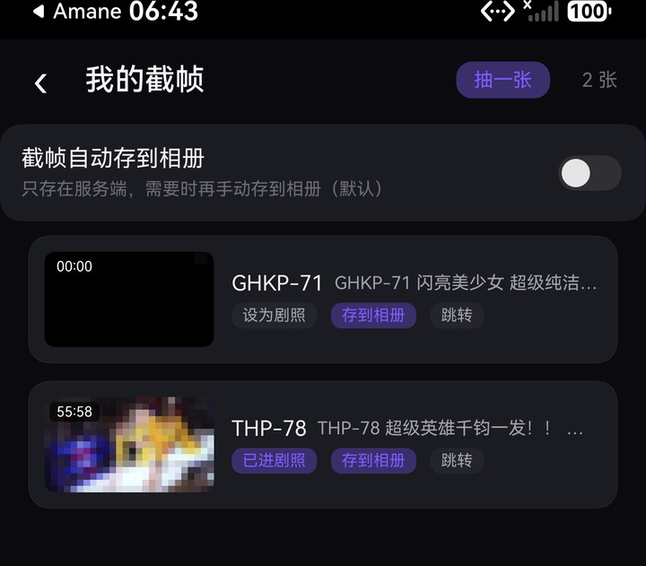
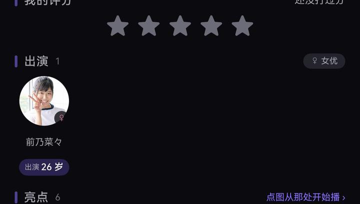
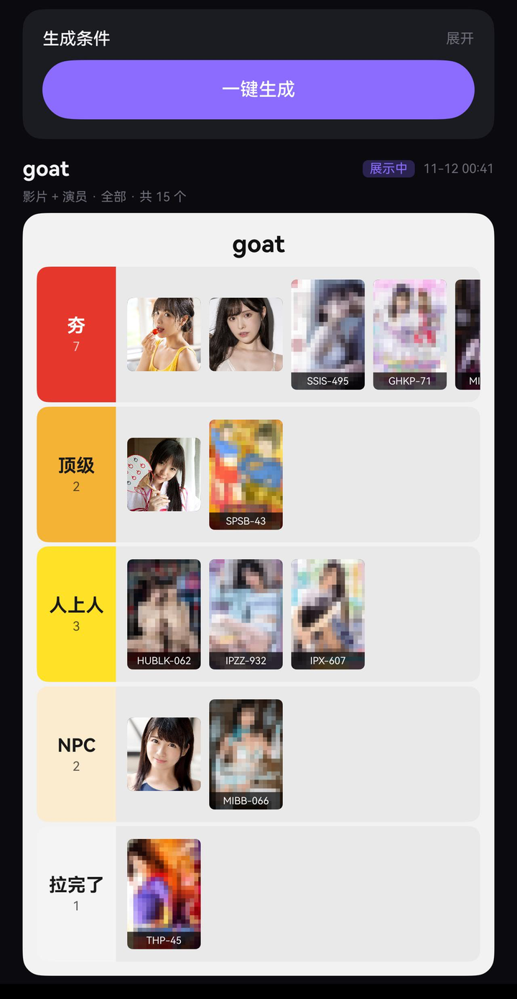
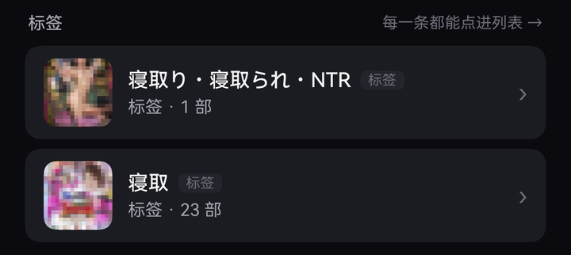
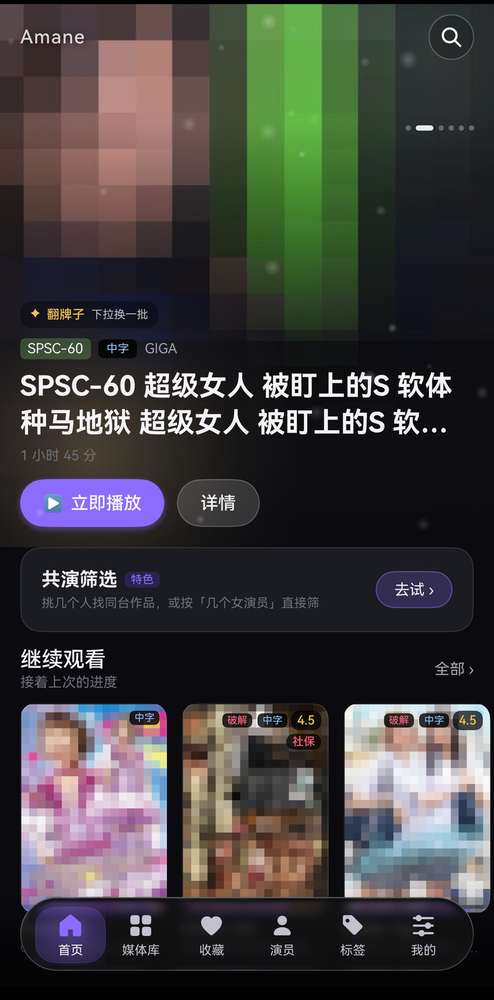
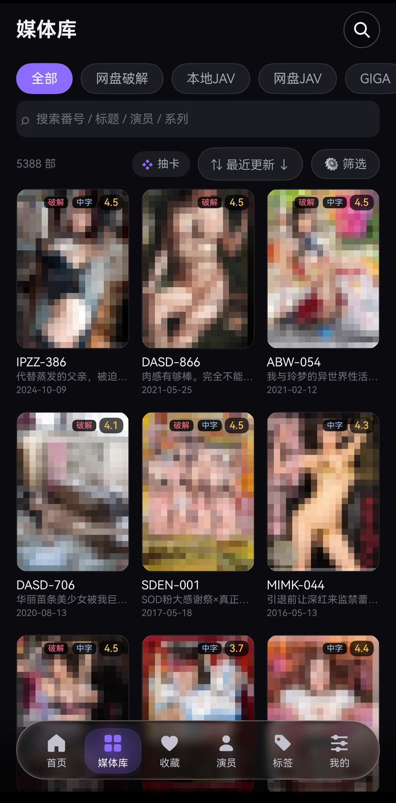
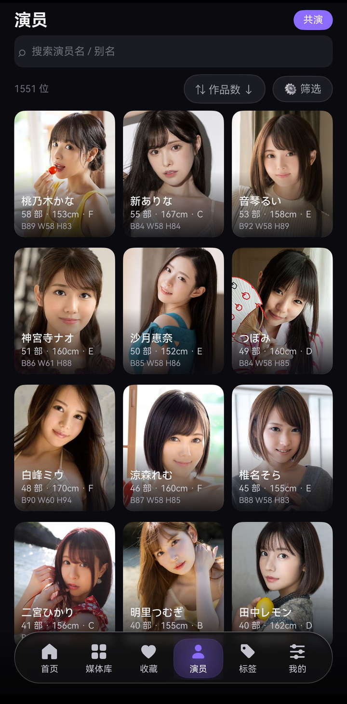
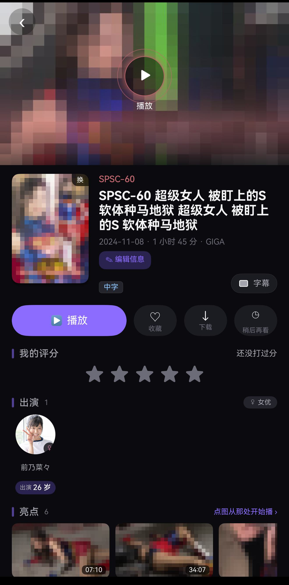
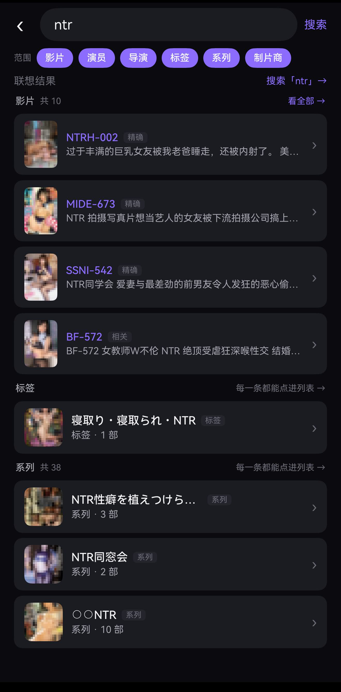

  

  
  
  
  
  
  

  <strong>发现下一部好片， 留住每一次精彩。</strong> 
  想找谁就认真找，没主意就刷一刷；看对眼的，从详情看到精彩，再留给下一次重逢。

共演检索 · 随机抽卡 · 丰富详情 · 记录回看

<strong>2.7.3</strong>　界面铺到屏幕边缘 · 底栏会自己让位 · 抽卡能一直滑 · 「我的」更短了 服务端已经能在 App 里升级：手机装包，服务器在「检查更新」里点一下。

> 把自己的 Amane 媒体库带到 HarmonyOS。沿着演员与共演找片，让随机剧照带来惊喜；打开详情了解阵容、选择版本，再把精彩画面、评分和观看记录留下来。2.7.0 让首页往右滑就能翻自己的片段；2.7.2 修好了刷一刷的手感，并让服务端能在 App 里升级；2.7.3 把界面推到屏幕边缘，底栏会自己让位。

> [!IMPORTANT]
> **2.7.2版本实装了半自动更新，不再需要反复手动pull，只需要在客户端检查更新，点击更新按钮即可。但必须手动升级到2.7.2才能使用此功能。** 服务端按「快速开始」重新部署一遍、手机装一次新包；
> 装好之后「检查更新」里就会出现「升级服务器」按钮，以后**服务端**的更新在 App 里点一下就行
> （手机端仍需下载安装包自己装 —— 鸿蒙不允许应用商店外自动安装）。
> 旧版本没有这套逻辑，**不能**指望它自己升上来。
> 已经在 2.7.2 及以上：这次的服务端更新可以在 App 里直接点，不用再动 docker。

> 截图取自作者自建媒体库；封面、横幅与剧照已打码，演员头像保留原样。

面向已有 Amane 媒体库的 HarmonyOS NEXT 手机用户，需部署旁挂服务并自行签名安装。 <strong>客户端升级到 2.7.3</strong>；服务端若已在 2.7.2 之上，可直接在「检查更新」里升级。<a href="docs/START.md">从零开始</a> · <a href="../../releases">下载</a>

## 快速开始

**完全不懂怎么装？看 [从零开始（傻瓜版）](docs/START.md)** —— 每一步都写了「做什么 / 看到什么算成功 / 不对怎么办」，装服务、签名装 App、连库、以后怎么更新都在里面。

已经知道自己在干什么的，按三步走：

1. **部署旁挂服务**　在运行 Amane 的机器上 `cp deploy/.env.example .env`，填好 `AMANE_DATA` 与 `MEDIA_PATH_MAP`，再 `docker compose -f deploy/compose.example.yml up -d`。
2. **安装客户端**　从 [Releases](../../releases) 下载 HAP，用你自己的证书签名后安装，或交给 Hokit 这类侧载工具。
3. **连接媒体库**　「我的 → 连接设置」填 Amane 地址 `:8000`、用户服务地址 `:8770` 与 API token。

详细步骤见 [部署指南](docs/DEPLOY.md) 与 [签名安装](docs/BUILD_HAP.md)；不想手写配置，就把部署指南开头那段话发给 AI 助手，它会用 `tools/agentctl.py` 带你部署并验证。

### 以后怎么更新

**服务端**：手机打开「我的 → 检查更新」，有新版本时会出现**「升级服务器」**按钮，点一下自己下载、校验、切换、重启，全程有进度条。
升级包落在服务端的数据卷 `<数据目录>/app`，**原来的 compose 不用改**，重建容器也不会把升级冲掉；失败或连续两次起不来自动退回上一版。

**手机端**：仍然要下载安装包自己装 —— 鸿蒙不允许应用商店外自动安装，这条改不了。

前提三条：服务端能访问 `github.com`（下载升级包）；数据目录可写（默认挂载就是可写）；服务端至少是 2.7.2（这套逻辑是那一版才有的，更早的版本只能按上面三步手动升一次）。

## 有趣的功能

<table>
  <tr>
    <td width="50%" align="center" valign="middle">
      
       
      <strong>① 共演检索</strong>　最多 6 位演员，「1 女 + 2 男」这种配比也能直接指定。
    </td>
    <td width="50%" align="center" valign="middle">
      
       
      <strong>② 抽卡</strong>　整屏随机剧照，从库到收藏，任意清单都能抽。
    </td>
  </tr>
  <tr>
    <td width="50%" align="center" valign="middle">
      
       
      <strong>③ 分类体系</strong>　演员、标签、系列、制片厂、导演都是能直接翻的墙。
    </td>
    <td width="50%" align="center" valign="middle">
      
       
      <strong>④ 亮点</strong>　带时间点的本片画面，点哪张从哪秒开始播。
    </td>
  </tr>
  <tr>
    <td width="50%" align="center" valign="middle">
      
       
      <strong>⑤ 截帧与回看</strong>　截图集中在一处，点一下空降那个场景。
    </td>
    <td width="50%" align="center" valign="middle">
      
       
      <strong>⑧ 出演年龄</strong>　点岁数就翻同龄的片，还能按女优 / 男优年龄排序。
    </td>
  </tr>
  <tr>
    <td width="50%" align="center" valign="middle">
      
       
      <strong>⑨ 元数据</strong>　系列按属性筛，制片厂按番号前缀连着翻。
    </td>
    <td width="50%" align="center" valign="middle">
      
       
      <strong>⑪ 观看统计</strong>　次数、时长、趋势和偏好放在一起看。
    </td>
  </tr>
  <tr>
    <td width="50%" align="center" valign="middle">
      
       
      <strong>⑫ 从夯到拉</strong>　评分生成五档座次图，可筛选、可导出。
    </td>
    <td width="50%" align="center" valign="middle">
      
       
      <strong>⑬ 搜索认俗称</strong>　拼音首字母、繁简写法和俗称一起帮你找。
    </td>
  </tr>
  <tr>
    <td width="50%" align="center" valign="middle">
      
      
       
      <strong>⑭ 刷一刷</strong>　首页右滑，一条一个片段，合口味就点个心。
    </td>
    <td width="50%" align="center" valign="middle">
      
      
       
      <strong>⑮ 首页自己挑</strong>　库、状态、年份、标签、演员，组合成首页范围。
    </td>
  </tr>
  <tr>
    <td width="50%" align="center" valign="middle">
      
       
      <strong>⑯ 备份与恢复</strong>　收藏评分清单能带走，导入先预览再挑。
    </td>
    <td width="50%" align="left" valign="middle">
      没有配图的三项：<strong>⑥ 播放体验</strong> 原地起播、三态窗口、退出记进度；<strong>⑦ 弹幕与评价</strong> 评价留给整片、弹幕留给那一刻；<strong>⑩ 打分</strong> 1–5 星，从夯到拉，顺手留句锐评。
    </td>
  </tr>
  <tr>
    <td colspan="2">「我的喜爱」存的是你点过心的片段，点一条就能回到那个位置；点心只记在这台手机上，和正片收藏分开。备份支持的类别以界面为准，按番号匹配，没对上的记录要自己看一眼。</td>
  </tr>
</table>

## 完善的基础功能

<table>
  <tr>
    <td width="25%" align="center" valign="top"> <strong>首页</strong> 想放啥放啥</td>
    <td width="25%" align="center" valign="top"> <strong>媒体库</strong> 7 种排序 · 抽卡</td>
    <td width="25%" align="center" valign="top"> <strong>演员</strong> 身材 · 年龄 · 收藏</td>
    <td width="25%" align="center" valign="top"> <strong>详情</strong> 一切信息 · 大众点评</td>
  </tr>
  <tr>
    <td align="center" valign="top"> <strong>剧照</strong> 喜欢就收起来</td>
    <td align="center" valign="top"> <strong>筛选</strong> 想怎么筛就怎么筛</td>
    <td align="center" valign="top"> <strong>搜索</strong> 联想 · 别名 · 拼音繁体</td>
    <td align="center" valign="top"> <strong>播放器</strong> 内置 mpv · 倍速 · 手势</td>
  </tr>
</table>

演员墙按身材和年龄挑：从娇小到丰满、从人妻到 JK，总有一款对味；想挑奶狗或大叔也不是不行。

想看的先放进**稍后再看**，喜欢的分进自己的**清单**；这次没看完，下次接着看。

多清单 · 稍后再看 · 自建标签与系列 · 手机编辑信息 · 8 套主题 · 列数可调 · 首页编排 · 空间管理 · 检查更新 · 设置分块 · 全矢量图标 · 导出日志

## 播放链路

想看看它怎么播得顺？展开看播放链路

- **块缓存**：读过的块留在内存（默认 320MB），拖动回看不回源。
- **并行预取**：提前读后续分段，网盘与冷区的首包更快。
- **mpv 硬解**：左右拖进度、竖直调亮度音量、0.75–2x 倍速、音轨字幕切换、退出记进度。
- **悬浮玻璃控制层**：视频从栏下透出，播放页两侧用封面晕出光晕。
- **参数锁定**：旧配置自动重置；诊断行看缓存秒数，一眼分清网络还是解码。

- **外挂字幕**：同目录 / 手机导入 / URL / 在线搜索，记住每部片的选择；多种常见编码自动转 WebVTT。

## 文档

功能细节、逐项配置、排障都在 **[Wiki](https://github.com/dogmicats/Amane-Harmony/wiki)**。

- 第一次装：[部署指南](docs/DEPLOY.md) · [签名安装](docs/BUILD_HAP.md)
- 已经有旧版：[升级服务端](docs/UPGRADE.md)（含一段可以直接发给 AI 助手的提示词）
- 使用与排错：[字幕](docs/SUBTITLES.md) · [兼容性](docs/COMPATIBILITY.md) · [排障](docs/TROUBLESHOOTING.md) · [非鸿蒙设备](docs/ANDROID.md)
- 维护与贡献：[README 设计规范](docs/DESIGN.md) · [AI 助手约定](AGENTS.md)

## 交流

- **[讨论群](https://t.me/+uYKKwB9LtjMxYTY9)** —— 装不上、用着别扭、想加什么功能，都在这儿说
- **[更新频道](https://t.me/+iEyg1f5Q_6UxYjY1)** —— 只发版本更新，不闲聊

版本发布后会自动往更新频道推一条（标题 + 本次更新摘要 + Release 链接）。

## 许可

MIT，见 [LICENSE](LICENSE)。第三方组件见 [THIRD_PARTY_NOTICES.md](THIRD_PARTY_NOTICES.md)。上游 Amane 见 [CITATION.cff](CITATION.cff)。

非官方第三方项目，与上游无隶属关系；本仓库不含媒体内容、服务器地址或凭据。
