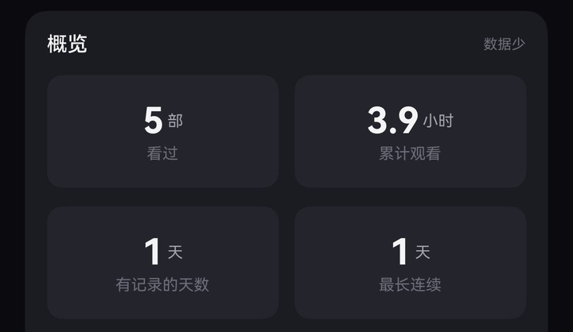
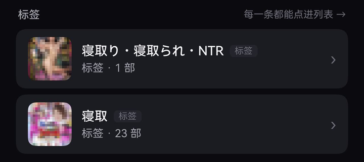

  

  
  
  
  
  
  

  <strong>发现下一部好片， 留住每一次精彩。</strong> 
  沿着演员与共演找片，跟着剧照发现惊喜；从详情开始观看，把亮点、评价与收藏留给下一次重逢。

共演检索 · 随机抽卡 · 丰富详情 · 记录回看

<strong>2.6.0 新增</strong>　俗称搜索 · 观看统计 · 自由整理 找片更顺手，看过有迹可循。

> 把自己的 Amane 媒体库带到 HarmonyOS。沿着演员与共演找片，让随机剧照带来惊喜；打开详情了解阵容、选择版本，再把精彩画面、评分和观看记录留下来。2.6.0 加入观看统计、俗称与别名检索，以及更多个人整理方式。

> 截图取自作者自建媒体库；封面、横幅与剧照已打码，演员头像保留原样。

面向已有 Amane 媒体库的 HarmonyOS NEXT 手机用户，需部署旁挂服务并自行签名安装。<a href="docs/START.md">从零开始</a> · <a href="../../releases">下载</a>

## 有趣的功能

<table>
  <tr>
    <td width="33%" valign="top">
       
      <strong>① 共演检索</strong> 
      想看导演 × 演员的合作、想看某几个人同台（男女、女女、男男都行）、还是就想找人多的大场面？一个筛选器全包：最多 6 位演员，「1 女 + 2 男」这种配比也能直接指定。 <strong>离散人数多选 · 导演可包含可排除</strong>
    </td>
    <td width="33%" valign="top">
       
      <strong>② 抽卡</strong> 
      片荒、列表翻到麻木的时候别选了——整屏随机剧照瀑布流，看上哪张看哪张；从媒体库到收藏、从演员的全部作品到搜索结果，任意清单都能抽。 <strong>不满意随时重抽 · 全站清单通用</strong>
    </td>
    <td width="33%" valign="top">
       
      <strong>③ 分类体系</strong> 
      Emby 连一个能翻的演员墙都没有——想看某个人的全部作品，得进设置翻 metadata 里的 people 文件夹自己导出来。标签管理更是混乱的鸡肋功能。这里演员、标签、系列、制片厂、导演都是能直接翻的墙，视图多变，保你好看。 <strong>多类入口 · 优化布局 · 横幅生成 · 可隐藏、可收藏</strong>
    </td>
  </tr>
</table>

④ **亮点**　自动生成带时间点的本片画面，点哪张从哪秒开始播；观看时随手截的帧也能插进亮点。后台管理列着你所有的截图，点一下直接空降你最爱的场景，再也不用盯着剧照拉进度条。

⑤ **播放体验**　用腻了旧 Emby 式播放器的古早操作逻辑？这里换成 B 站客户端那套：详情页原地起播，小窗 / 全屏 / 横屏随手切，退出记着进度；倍速、手势、亮度音量都在手边。 <strong>原地起播 · 三态窗口 · 记住进度</strong>

⑥ **弹幕与评价**　对整部片想锐评？看到一半想说点啥？增加了弹幕与评价功能。连接 Amane 的评价数据库，你的评价也能提交；看到一半还可以随时发送弹幕，锐评场景。飞行式滚动、样式可调，支持后台查看并管理所有你自己的弹幕和评价，点击一键跳转详情页。

⑦ **出演年龄**　演员行标着出演本片时的岁数，点一下岁数就翻同龄的片，结果还能按女优 / 男优年龄排序。那年，她多大？

⑧ **元数据价值最大化**　同一批元数据能干的活不少：系列按属性筛、制片厂按番号前缀连着翻、演员按年龄和身材当索引。想找的很好找，不知道看什么让抽卡推，看对眼的就一路看下去。 <strong>系列属性 · 番号前缀 · 一路翻片</strong>

⑨ **打分**　1–5 星，配菜、有意思、对味、反复、社保——JAV 也有自己的从夯到拉：一眼看出这部片在你心里什么位置，顺手还能留句锐评。

⑩ **观看统计**　看过不少，回头却只记得几张海报？把这台设备记录的观看次数、时长、趋势和偏好放到一起，看看最近把时间花在了哪里。记录还少时会提醒「还在积累」，不用把空白当成结论。 <strong>观看概览 · 趋势回看 · 偏好榜</strong>

⑪ **从夯到拉**　打过的星，值得排出来看看。把个人评分生成五档座次图，筛一筛想放在一起比较的作品，再把这一刻的选择保存下来。以后口味变了，重新生成就是另一张记录。 <strong>五档座次 · 条件筛选 · 导出图片</strong>

⑫ **搜索认俗称**　名字记得住，写法却不一定记得准。拼音首字母、繁简写法和俗称一起帮你找；还没对应上的叫法，可以加入自己的别名，下次想起它时，用熟悉的名字继续找。 <strong>拼音首字母 · 写法归一 · 别名维护</strong>

## 完善的基础功能

<table>
  <tr>
    <td width="25%" align="center" valign="top"> <strong>首页</strong> 想放啥放啥 · 继续观看 · 每日推荐</td>
    <td width="25%" align="center" valign="top"> <strong>媒体库</strong> 7 种排序 · 5 类筛选 · 抽卡</td>
    <td width="25%" align="center" valign="top"> <strong>演员</strong> 身材 · 年龄 · 收藏</td>
    <td width="25%" align="center" valign="top"> <strong>详情</strong> 一切信息 · 大众点评 · 相似影片</td>
  </tr>
  <tr>
    <td align="center" valign="top"> <strong>剧照</strong> 瀑布流 · 标记喜爱 · 尽收眼底</td>
    <td align="center" valign="top"> <strong>筛选</strong> 想怎么筛就怎么筛</td>
    <td align="center" valign="top"> <strong>搜索</strong> 联想 · 别名 · 拼音繁体</td>
    <td align="center" valign="top"> <strong>播放器</strong> 内置 mpv · 倍速 · 手势</td>
  </tr>
</table>

演员墙按身材和年龄挑：从娇小到丰满、从人妻到 JK，总有一款对味；想挑奶狗或大叔也不是不行。

多清单 · 稍后再看 · 自建标签与系列 · 手机编辑信息 · 8 套主题 · 列数可调 · 首页编排 · 检查更新 · 设置分块 · 全矢量图标 · 导出日志

## 播放链路

- **块缓存**：读过的块留在内存（默认 320MB），拖动回看不回源。
- **并行预取**：提前读后续分段，网盘与冷区的首包更快。
- **mpv 硬解**：左右拖进度、竖直调亮度音量、0.75–2x 倍速、音轨字幕切换、退出记进度。
- **悬浮玻璃控制层**：视频从栏下透出，播放页两侧用封面晕出光晕。
- **参数锁定**：旧配置自动重置；诊断行看缓存秒数，一眼分清网络还是解码。
- **外挂字幕**：同目录 / 手机导入 / URL / 在线搜索，记住每部片的选择；多种常见编码自动转 WebVTT。

## 快速开始

**完全不懂怎么装？看 [从零开始（傻瓜版）](docs/START.md)** —— 每一步都写了「做什么 / 看到什么算成功 / 不对怎么办」，装服务、签名装 App、连库、以后怎么更新都在里面。

已经知道自己在干什么的，看这张表：

| 01 · 部署旁挂服务 | 02 · 安装客户端 | 03 · 连接媒体库 |
|---|---|---|
| 在运行 Amane 的机器上 `cp deploy/.env.example .env` 填好 `AMANE_DATA` 与 `MEDIA_PATH_MAP`，`docker compose -f deploy/compose.example.yml up -d` | 从 [Releases](../../releases) 下载 HAP，用你自己的证书签名后安装，或用 Hokit 等侧载工具 | 「我的 → 连接设置」填 Amane 地址 `:8000`、用户服务地址 `:8770` 与 API token |

详细步骤见 [部署指南](docs/DEPLOY.md) 与 [签名安装](docs/BUILD_HAP.md)；不想手写配置，就把部署指南开头那段话发给 AI 助手，它会用 `tools/agentctl.py` 带你部署并验证。

## 文档

功能细节、逐项配置、排障都在 **[Wiki](https://github.com/dogmicats/Amane-Harmony/wiki)**。

- 第一次装：[部署指南](docs/DEPLOY.md) · [签名安装](docs/BUILD_HAP.md)
- 已经有旧版：[升级服务端](docs/UPGRADE.md)（含一段可以直接发给 AI 助手的提示词）

## 交流

- **[讨论群](https://t.me/+uYKKwB9LtjMxYTY9)** —— 装不上、用着别扭、想加什么功能，都在这儿说
- **[更新频道](https://t.me/+iEyg1f5Q_6UxYjY1)** —— 只发版本更新，不闲聊

版本发布后会自动往更新频道推一条（标题 + 本次更新摘要 + Release 链接）。

仓库内另有：[部署](docs/DEPLOY.md) · [签名安装](docs/BUILD_HAP.md) · [字幕](docs/SUBTITLES.md) · [兼容性](docs/COMPATIBILITY.md) · [排障](docs/TROUBLESHOOTING.md) · [非鸿蒙设备](docs/ANDROID.md) · [README 设计规范](docs/DESIGN.md) · [AI 助手约定](AGENTS.md)。

## 许可

MIT，见 [LICENSE](LICENSE)。第三方组件见 [THIRD_PARTY_NOTICES.md](THIRD_PARTY_NOTICES.md)。上游 Amane 见 [CITATION.cff](CITATION.cff)。

非官方第三方项目，与上游无隶属关系；本仓库不含媒体内容、服务器地址或凭据。
