

  

  
  
  
  
  
  

  <strong>发现下一部好片， 留住每一次精彩。</strong> 
  想找谁就认真找，没主意就刷一刷；看对眼的，从详情看到精彩，再留给下一次重逢。

共演甄选 · 随机抽卡 · 丰富详情 · 记录回看

<strong>2.9.1</strong>　字幕自己找，自己挑 · 我的口味与推荐正式进包 · 新图标、新启动动画与蔷薇液态玻璃界面 小窗不再挡住页面点击，回桌面可用画中画接着看；手机端仍需自己签名装包。

> 把自己的 Amane 媒体库带到 HarmonyOS NEXT。沿着演员、甄选与口味发现好片，没中文字幕时交给「字幕管理」自动找、自动挑；点开详情直接播放，再把精彩画面、评分和观看记录留下来。2.7.2 起服务端能在 App 里点一下升级；2.9.0 换上全新液态玻璃丝带图标与默认「蔷薇」主题，2.9.1 又修好了小窗挡住点击的问题，从打开到看片都更顺手。

> [!IMPORTANT]
> **服务端低于 2.7.2 时，先手动升一次到 2.7.2 或更新版本**；已经在 2.7.2 及以上，打开 App「我的 → 关于 → 检查更新」点「升级服务器」即可自动下载、校验、切换并重启（失败自动回滚）。
> 手机端仍需下载安装包自行签名安装 —— 鸿蒙不允许应用商店外自动安装。

> 截图取自作者自建媒体库；封面、横幅与剧照已打码，演员头像保留原样。

面向已有 Amane 媒体库的 HarmonyOS NEXT 手机用户，需部署旁挂服务并自行签名安装。 <strong>客户端与服务端配套到 2.9.1</strong>；只升手机、保留旧服务端时，自动补字幕与多库甄选会受限。<a href="docs/START.md">从零开始</a> · <a href="../../releases">下载</a>

## 快速开始

**完全不懂怎么装？看 [从零开始（傻瓜版）](docs/START.md)** —— 每一步都写了「做什么 / 看到什么算成功 / 不对怎么办」，装服务、签名装 App、连库、以后怎么更新都在里面。

已经知道自己在干什么的，按三步走：

1. **部署旁挂服务**　在运行 Amane 的机器上 `cp deploy/.env.example .env`，填好 `AMANE_DATA` 与 `MEDIA_PATH_MAP`，再 `docker compose -f deploy/compose.example.yml up -d`。
2. **安装客户端**　从 [Releases](../../releases) 下载 `Amane-2.9.1-unsigned.hap`，用你自己的证书签名后安装，或交给 Hokit 这类侧载工具。
3. **连接媒体库**　「我的 → 连接设置」填 Amane 地址 `:8000`、用户服务地址 `:8770` 与 API token。

详细步骤见 [部署指南](docs/DEPLOY.md) 与 [签名安装](docs/BUILD_HAP.md)；不想手写配置，就把部署指南开头那段话发给 AI 助手，它会用 `tools/agentctl.py` 带你部署并验证。

### 以后怎么更新

**服务端**：手机打开「我的 → 关于 → 检查更新」，有新版本时点「升级服务器」。升级包落在服务端数据卷 `<数据目录>/app`，原来的 compose 不用改，重建容器也不会冲掉；失败或连续两次起不来自动退回上一版。

**手机端**：下载安装包自己装 —— 鸿蒙不允许应用商店外自动安装。

前提三条：服务端能访问 `github.com`；数据目录可写；服务端至少 2.7.2。低于 2.7.2 请先按 [升级服务端](docs/UPGRADE.md) 手动升一次。

## 有趣的功能

<table>
  <tr>
    <td width="50%" valign="top">
      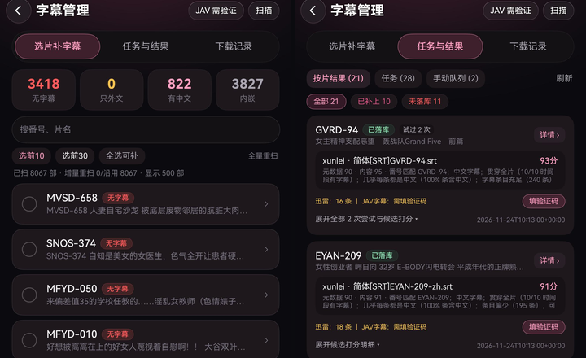
       
      <strong>① 字幕自己找，自己挑</strong>　没中文字幕不用再翻站对时长：全库体检、双源检索、按时长与中文密度打分挑最优，任务进度看得见也能取消，没补上写清原因。
    </td>
    <td width="50%" valign="top">
      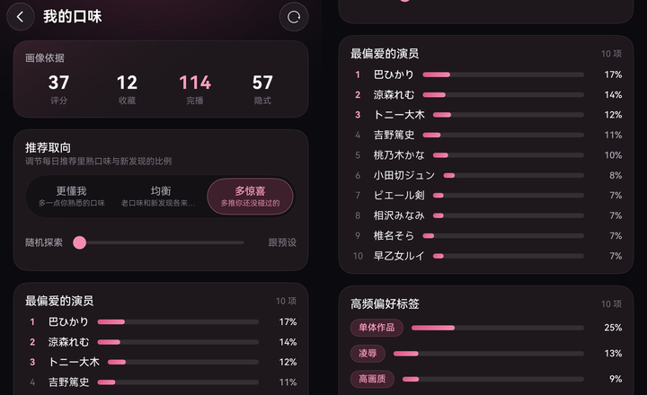
       
      <strong>② 我的口味与推荐</strong>　基于你自己的库生成口味画像，「更懂我 / 均衡 / 多惊喜」三档加探索滑杆自由调，多样性闸防刷屏；负一屏点「⋯」直接改刷片范围。
    </td>
  </tr>
  <tr>
    <td width="50%" valign="top">
      
       
      <strong>③ 新图标，蔷薇液态玻璃</strong>　换上 3D 液态玻璃丝带图标与一镜到底启动过渡，新装默认「蔷薇」主题；详情、播放控件、字幕面板与悬浮底栏统一样式，列表边缘不再闪黑带。
    </td>
    <td width="50%" valign="top">
      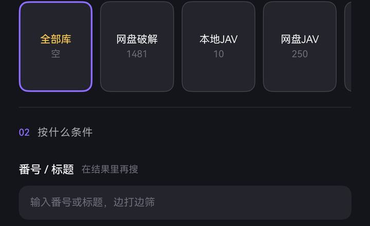
       
      <strong>④ 甄选先圈范围</strong>　找共演与高级筛选合在一起：演员、导演、标签、系列、制片商一起下条件，结果里还能再搜，俗称也能命中。
    </td>
  </tr>
  <tr>
    <td width="50%" valign="top">
      
       
      <strong>⑤ 抽卡跟着筛选走</strong>　筛出来的片子就是卡池；画质、字幕、年份、评分、状态都算，多库只抽两边共有的。
    </td>
    <td width="50%" valign="top">
      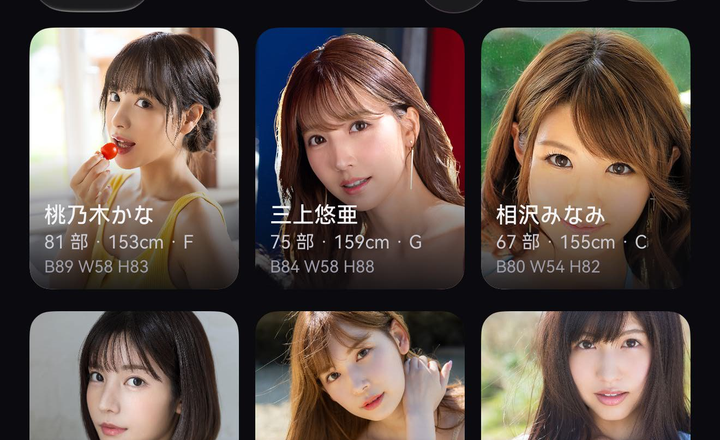
       
      <strong>⑥ 演员墙</strong>　从熟悉的人一路翻到作品，按身材、年龄、作品数挑；点开能看别名、写真与出演年龄。
    </td>
  </tr>
  <tr>
    <td width="50%" valign="top">
      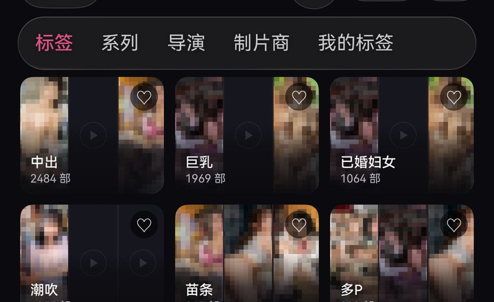
       
      <strong>⑦ 分类体系</strong>　标签、系列、导演、制片商都能翻；番号前缀、系列属性、收藏隐藏在同一套版式里。
    </td>
    <td width="50%" valign="top">
      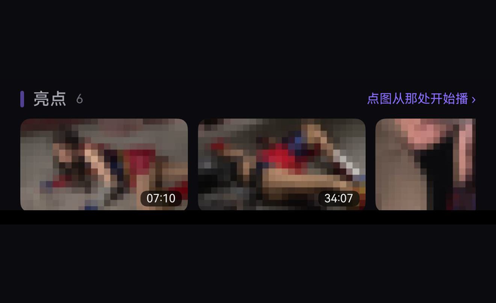
       
      <strong>⑧ 亮点</strong>　详情页那几条自己的画面带时间点，点哪张从哪秒开始播；网盘片首次打开会现场抽帧。
    </td>
  </tr>
  <tr>
    <td width="50%" valign="top">
      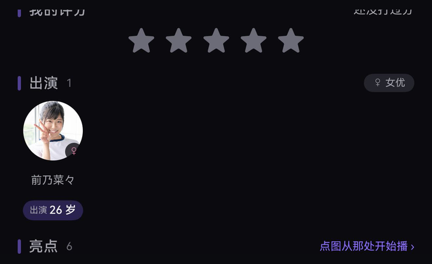
       
      <strong>⑨ 出演年龄</strong>　演员行直接标「出演 N 岁」，点一下翻同龄片，女优 / 男优都能排。
    </td>
    <td width="50%" valign="top">
      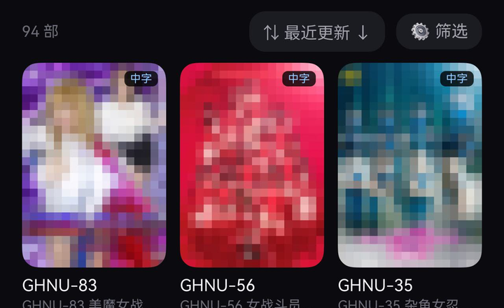
       
      <strong>⑩ 元数据</strong>　系列按属性筛，制片厂按番号前缀连着翻；片名、标签和封面在手机上就能改。
    </td>
  </tr>
  <tr>
    <td width="50%" valign="top">
      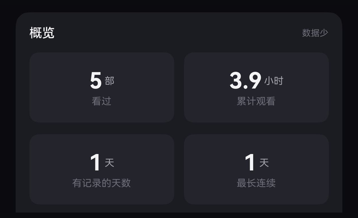
       
      <strong>⑪ 观看统计</strong>　次数、时长、趋势和偏好放一起看；样本少时明说「还在积累」，不拿 0 骗人。
    </td>
    <td width="50%" valign="top">
      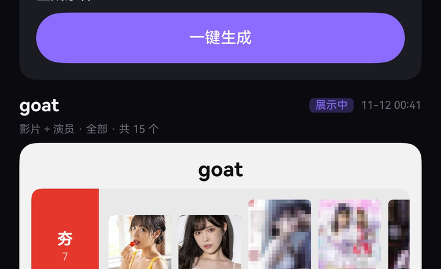
       
      <strong>⑫ 从夯到拉</strong>　星级排成五档座次，按内容、时间、性别筛，也能导出成图。
    </td>
  </tr>
  <tr>
    <td width="50%" valign="top">
      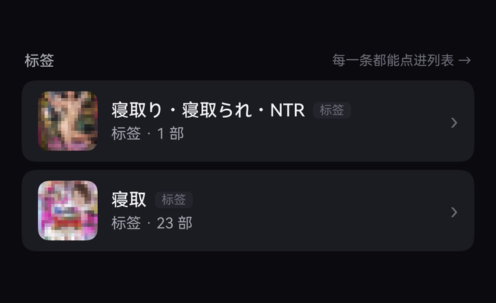
       
      <strong>⑬ 搜索认俗称</strong>　拼音、繁简、日文写法和俗称一起找；搜不到的词进「待处理」，点一下就成了别名。
    </td>
    <td width="50%" valign="top">
      
       
      <strong>⑭ 刷一刷</strong>　首页右滑，一条一个片段，点心留住那一下。「我的喜爱」只存本机，和正片收藏分开。
    </td>
  </tr>
  <tr>
    <td width="50%" valign="top">
      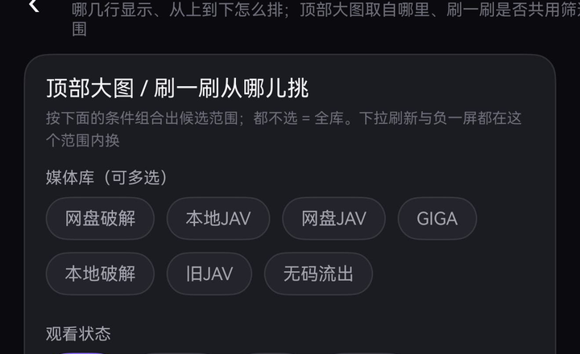
       
      <strong>⑮ 首页自己挑</strong>　库、状态、年份、标签、演员组合成首页范围，打开先看自己挑的那几行。
    </td>
    <td width="50%" valign="top">
      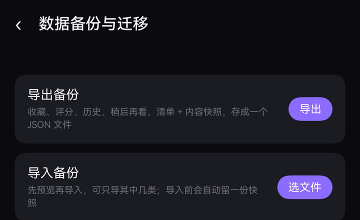
       
      <strong>⑯ 备份与恢复</strong>　收藏评分清单能带走，导入先预览再挑；线上记录按番号匹配。
    </td>
  </tr>
  <tr>
    <td colspan="2" valign="top">
      没有配图的三项：<strong>⑰ 播放体验</strong> 原地起播、三态窗口、横竖屏液态玻璃控件、左亮度右音量平滑调节、退出记进度；<strong>⑱ 弹幕与评价</strong> 评价留给整片，弹幕留给那一刻；<strong>⑲ 打分</strong> 1–5 星，从夯到拉，顺手留句锐评。
    </td>
  </tr>
</table>

## 完善的基础功能

<table>
  <tr>
    <td width="25%" valign="top"> <strong>首页</strong> 想放啥放啥</td>
    <td width="25%" valign="top">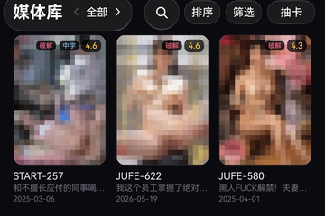 <strong>媒体库</strong> 多库 · 抽卡</td>
    <td width="25%" valign="top">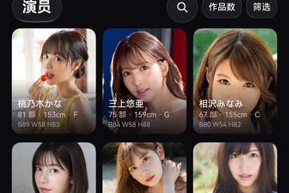 <strong>演员</strong> 身材 · 年龄</td>
    <td width="25%" valign="top"> <strong>详情</strong> 阵容 · 版本</td>
  </tr>
  <tr>
    <td valign="top"> <strong>剧照</strong> 喜欢就收起来</td>
    <td valign="top">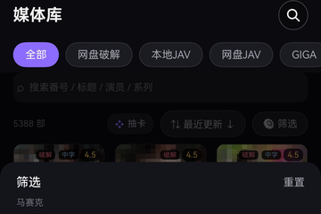 <strong>筛选</strong> 想怎么筛就怎么筛</td>
    <td valign="top">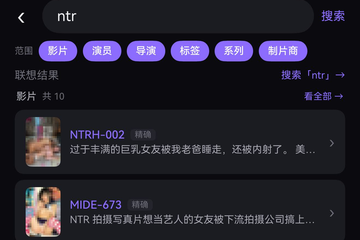 <strong>搜索</strong> 联想 · 别名</td>
    <td valign="top">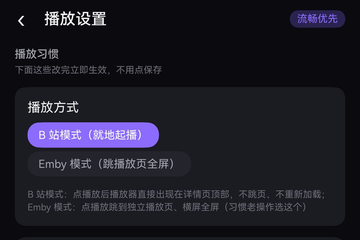 <strong>播放器</strong> mpv · 倍速</td>
  </tr>
</table>

想看的先放进**稍后再看**，喜欢的分进自己的**清单**；这次没看完，下次接着看。

多清单 · 稍后再看 · 自建标签与系列 · 手机编辑信息 · 8 套主题 · 列数可调 · 首页编排 · 空间管理 · 检查更新 · 设置分块 · 全矢量图标 · 导出日志

## 播放链路

想看看它怎么播得顺？展开看播放链路

- **块缓存**：读过的块留在内存（默认 320MB），拖动回看不回源。
- **并行预取**：提前读后续分段，网盘与冷区的首包更快。
- **mpv 硬解**：左右拖进度（上滑可取消）、竖直平滑调亮度音量、0.75–2x 倍速、锁屏防误触、画面比例切换、退出记进度。
- **悬浮液态玻璃控制层**：视频从栏下透出，小窗与展开面板统一样式。
- **参数锁定**：旧配置自动重置；诊断行看缓存秒数，一眼分清网络还是解码。

- **外挂字幕**：同目录 / 手机导入 / URL / 在线搜索与一键自动补，去重并记住每部片的选择，支持播放中提前 / 延后时间轴；多种常见编码自动转 WebVTT。

## 文档

功能细节、逐项配置、排障都在 **[Wiki](https://github.com/dogmicats/Amane-Harmony/wiki)**。

- 第一次装：[部署指南](docs/DEPLOY.md) · [签名安装](docs/BUILD_HAP.md) · [从零开始](docs/START.md)
- 已经有旧版：[升级服务端](docs/UPGRADE.md)（含一段可以直接发给 AI 助手的提示词）
- 使用与排错：[字幕](docs/SUBTITLES.md) · [兼容性](docs/COMPATIBILITY.md) · [排障](docs/TROUBLESHOOTING.md) · [非鸿蒙设备](docs/ANDROID.md)
- 维护与贡献：[README 设计规范](docs/DESIGN.md) · [AI 助手约定](AGENTS.md)

## 交流

- **[讨论群](https://t.me/+uYKKwB9LtjMxYTY9)** —— 装不上、用着别扭、想加什么功能，都在这儿说
- **[更新频道](https://t.me/+iEyg1f5Q_6UxYjY1)** —— 只发版本更新，不闲聊

版本发布后会自动往更新频道推一条（标题 + 本次更新摘要 + Release 链接）。

## 许可

MIT，见 [LICENSE](LICENSE)。第三方组件见 [THIRD_PARTY_NOTICES.md](THIRD_PARTY_NOTICES.md)。上游 Amane 见 [CITATION.cff](CITATION.cff)。

非官方第三方项目，与上游无隶属关系；本仓库不含媒体内容、服务器地址或凭据。
